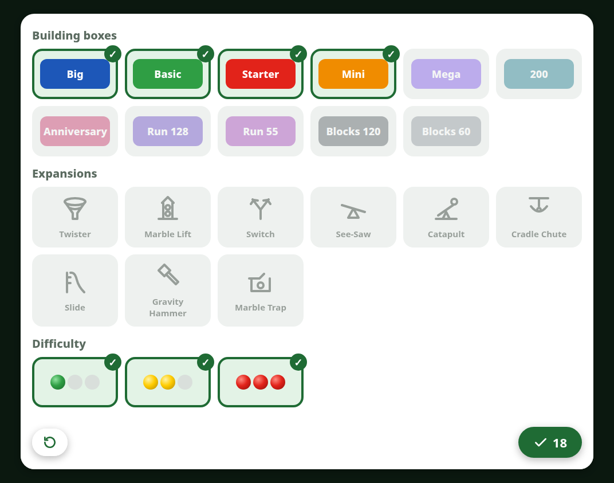

# marble-run-instructions

A small web app that lets kids browse the Hubelino marble run building instructions on a tablet by themselves.
By default it shows the runs that can be built with the **Hubelino Big Building Box (Baukasten maxi, 420572)**;
a filter adds other building boxes and expansions.
Hubelino bricks are compatible with LEGO® DUPLO® bricks, so the runs can be extended with them.

A private hobby project, not affiliated with Hubelino or the LEGO Group.



## Features

- Menu of all runs with their covers, sorted by part count, with a traffic-light difficulty
  (green up to 50 parts, yellow up to 120, red above) and labels for the sets each run needs.
- Filter by building box, expansion and difficulty. A run appears when *all* sets it needs are selected.
- One page per screen: swipe or tap the large arrows, pinch to zoom. The app remembers the last page of each run.
- Favorites (star) stay at the top of the menu regardless of the filter.
- German if the browser is set to German, English otherwise.

Favorites, progress and filter live in the browser's `localStorage` on the tablet.

## Instructions

The build takes every instruction from the hubelino.de API except the "Kugelbahn pi" line (440…),
a separate system with different parts. Sets, their article numbers, names, colors and icons are in
[`build/instructions.json`](build/instructions.json); `exclude` hides single instructions. An instruction
whose name contains an unknown article number gets a gray label and a build warning.

The default selection (Big, Basic, Starter, Mini) is the set of instructions whose parts lists were checked
against the Big Building Box.

## Running (Docker)

```sh
docker compose up -d --build
```

The build downloads the PDFs and renders every page as a JPEG, which takes a few minutes the first time
(the PDFs stay in the BuildKit cache). Run the same command again to pick up new instructions.

The container listens on port 8420. Put a reverse proxy with HTTPS in front of it (e.g. Caddy):
without HTTPS the app can't be installed and the screen can't be kept on.
Docker bypasses ufw/firewalld, so if the proxy runs on the same machine, bind the port to
`127.0.0.1:8420:80` in `compose.yaml` to keep it off the internet.

To install on an Android tablet, open the HTTPS address in Chrome and choose ⋮ → "Add to Home screen".

## Development

```sh
python3 build/build.py               # needs poppler-utils
python3 -m http.server -d site 8420
```

`build/build.py` writes the pages and `index.json` to `site/data/`. The app in `site/` has no framework or build step.

## Copyright and license

The instructions are Hubelino's copyrighted material. They are not in this repo but downloaded during the build,
and the app is meant for private use in your own network. Don't publish the built Docker image.

The code is under the [MIT License](LICENSE), which doesn't cover Hubelino's instructions, images or trademarks.
LEGO® and DUPLO® are trademarks of the LEGO Group, which does not sponsor, authorize or endorse this project.
